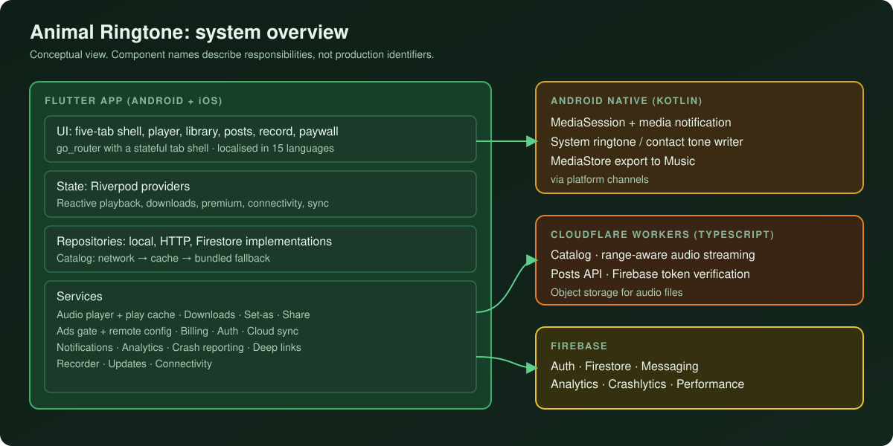
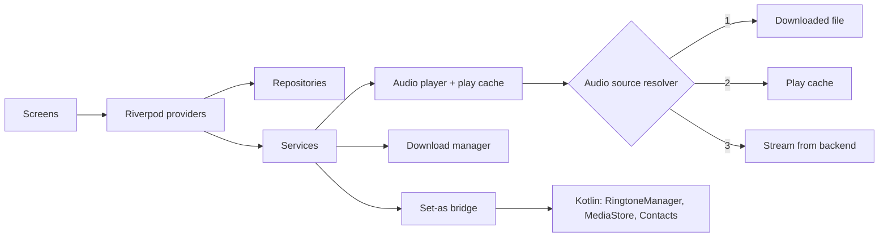

# Animal Ringtone

**A sound library and ringtone app for animal and bird sounds, with offline downloads, system ringtone/alarm/notification/contact assignment on Android, user recordings and a moderated community feed.**

**Android · iOS** 
Flutter · Dart · Riverpod · Firebase · Cloudflare Workers · Native Kotlin

<table>
  <tr>
    <td></td>
    <td></td>
  </tr>
</table>
Real screenshots from the Android app.

---

## Live App

  

## Product at a Glance

| | |
|---|---|
| **What it is** | Animal and bird sound library that doubles as a ringtone, alarm, notification and contact-tone picker |
| **Platforms** | Android and iOS (Flutter). Setting system sounds is Android-only; iOS gets a share-based alternative |
| **Content** | Catalog of animal sounds in seven categories (wild, birds, pets, farm, ocean, funny, ambient) served from a cloud backend with a bundled fallback |
| **Community** | Record your own sound, post it to a feed, like, share, report and block, with a moderation queue |
| **Monetisation** | Premium subscription or lifetime purchase, rewarded-ad unlocks, interstitial and banner/native ads behind a remote kill switch |
| **Backend** | Cloudflare Workers (TypeScript) for catalog, audio streaming and posts; Firebase for auth, data, messaging and analytics |
| **Code size** | About 79k lines of Dart in the app, plus a TypeScript Workers backend and Kotlin media/ringtone bridges |
| **Languages** | 15 UI languages, including Arabic and Urdu |

## Live Product Showcase

<table>
  <tr>
    <td align="center"> <b>Today's Animal Sound</b> Daily featured sound, play / favourite / share</td>
    <td align="center"> <b>Premium paywall</b> Monthly, annual (7-day trial) and lifetime</td>
    <td align="center"> <b>Permission pre-prompt</b> Explains before asking, with "Don't ask again"</td>
    <td align="center"> <b>Language selection</b> 15 languages</td>
  </tr>
  <tr>
    <td align="center"> <b>Offline storage</b> Downloads and play cache management</td>
    <td align="center"> <b>Guided tour</b> 12-step coach-mark walkthrough</td>
    <td></td>
    <td></td>
  </tr>
</table>

## Key Features

- **Library and player.** Category browsing, search with history, favourites, recently played, trending, a shared player with waveform, previous/next and autoplay.
- **Set as ringtone, alarm, notification or contact tone (Android).** Writes the system default sounds, or assigns a custom ringtone to a single contact.
- **Offline.** Download sounds for offline playback and export a copy to the public Music folder so it shows in the Files app. Streamed sounds are cached automatically after first play.
- **Background playback controls.** Android media session and notification with lock-screen controls; Now Playing integration on iOS.
- **Record and share.** Record a short clip, rename and manage recordings, post to the community feed or share through the OS share sheet.
- **Community safeguards.** Report content, block users, and an admin moderation queue backed by role-checked Firestore rules. Posting requires sign-in.
- **Accounts and sync.** Google and Apple sign-in. Favourites, recents, search history and settings sync across devices with live listeners. Account deletion and app reset are built in.
- **Notifications.** Push and local notifications, a deterministic daily featured sound, and an in-app notification centre.
- **Deep links.** Shared posts open directly in the app through a custom scheme or an app link, and via the Play install referrer on first launch.

## Engineering Highlights

### Setting a system ringtone without piling up files
- **Problem:** Android only lets an app set default sounds with a special write-settings permission, and naive implementations insert a new media file on every tap.
- **Approach:** a native bridge checks the permission and OS level first, stages the audio to a temp file, reuses an existing MediaStore entry for the same title, writes the default through `RingtoneManager`, then always deletes the staged file. Failures map to specific error codes that become localised messages.
- **Outcome:** repeated "Set as" taps for the same sound do not create duplicates, and a permission or file problem produces a clear message instead of a generic failure. iOS, which has no equivalent API, gets an explanatory flow and a share-to-GarageBand style alternative.

### One place decides where audio comes from
- **Problem:** the UI should not care whether a sound is downloaded, previously streamed, or must be streamed now.
- **Approach:** a single resolver picks, in order, a downloaded file, a play-cached file, then a streaming URL. Streams are transparently saved to a best-effort cache in the background. A call token stops rapid taps from interleaving on the one shared player.
- **Outcome:** replaying a sound does not re-stream it, deleted or corrupt local files fall back to streaming rather than crashing, and the player and waveform UI stay consistent across screens.

### Ads that fail closed
- **Problem:** ad placements are controlled remotely and the app also has places where an ad must never appear.
- **Approach:** per-placement flags and a global kill switch are read from Firestore. Until a real read succeeds in the session, every placement is treated as off. Premium users are skipped in each gate as defence in depth, and rewarded unlocks are per sound with an expiry.
- **Outcome:** no ad is requested on an unknown config, and monetisation logic stays out of the screens.

### Media session that does not block the main thread
- **Problem:** lock-screen and notification artwork needs bitmaps, and loading them on the calling thread caused ANRs.
- **Approach:** the native media-session controller shows a synchronous placeholder immediately and loads real artwork on a background thread, ignoring results that arrive after the track changed.
- **Outcome:** playback starts without waiting on artwork I/O.

More: [docs/ENGINEERING_CHALLENGES.md](docs/ENGINEERING_CHALLENGES.md).

## Architecture

  

Details: [docs/ARCHITECTURE.md](docs/ARCHITECTURE.md).

## Technology Stack

| Layer | Technology |
|---|---|
| App | Flutter / Dart 3, `go_router`, `flutter_riverpod` |
| Audio | `just_audio`, `just_audio_background`, `audio_session`, native Android MediaSession, `record` |
| Backend | Cloudflare Workers, TypeScript, Hono, `jose`, object storage |
| Firebase | Auth, Firestore, Messaging, Analytics, Crashlytics, Performance |
| Sign-in | Google, Apple |
| Billing | `in_app_purchase` (Play Billing / StoreKit) |
| Ads | Mediation SDK with several ad networks |
| Platform | `permission_handler`, `share_plus`, `app_links`, `in_app_update`, `app_tracking_transparency` |
| Native | Kotlin (media session, ringtone and contact bridges, MediaStore export) |
| Tooling | R8 minification and resource shrinking, generated localisation |

## Documentation

| Read | For |
|---|---|
| [Technical case study](docs/TECHNICAL_CASE_STUDY.md) | End-to-end write-up |
| [Architecture](docs/ARCHITECTURE.md) | Layers, flows and diagrams |
| [Engineering challenges](docs/ENGINEERING_CHALLENGES.md) | Problem, approach, trade-offs, outcome |
| [Product overview](docs/PRODUCT_OVERVIEW.md) | Features, screens and flows |
| [Privacy and source](docs/PRIVACY_AND_SOURCE.md) | What is and is not published |

## Source Code

This repository is a portfolio showcase for a production application. Production source code is maintained privately. See [RIGHTS.md](RIGHTS.md) for usage terms.
