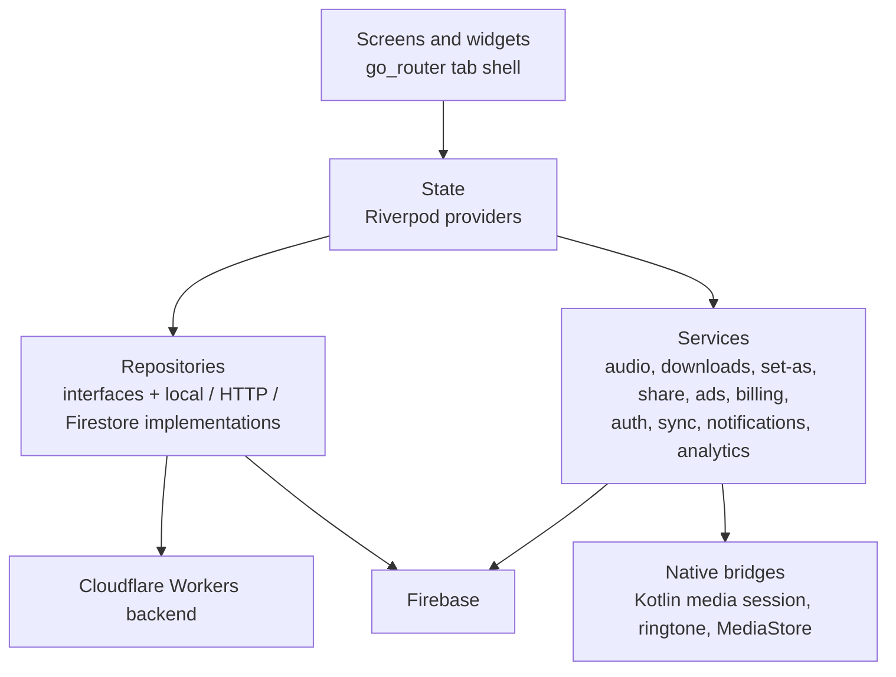
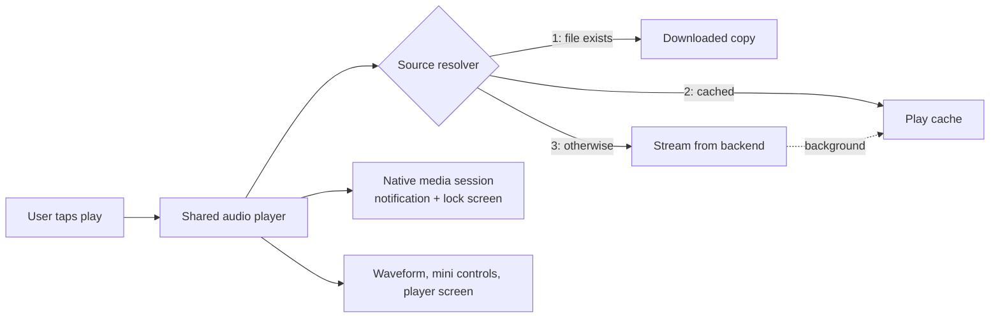
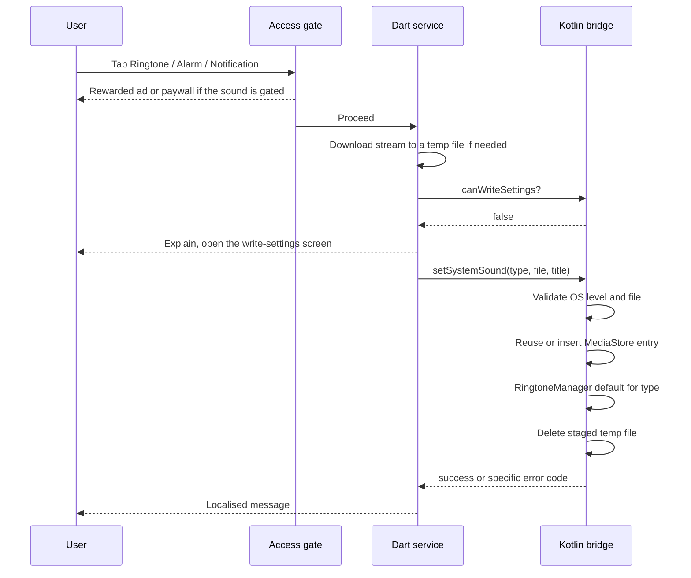
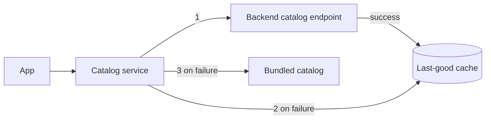
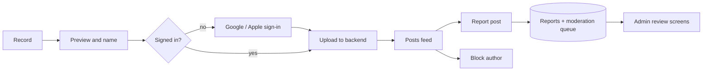
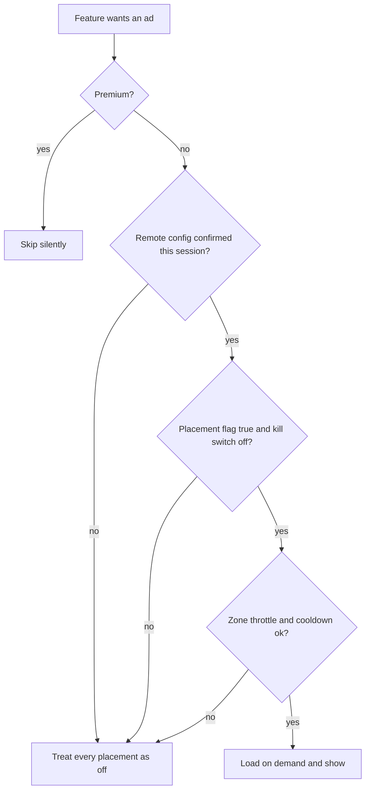

# Architecture

All diagrams are original and conceptual. They describe responsibilities, not production class or file names.

## 1. Layers

Rules the code follows:

- Widgets talk to providers and services, not to SDKs. Billing, ads, notifications and permissions each have one facade.
- Repositories sit behind interfaces, with implementations chosen by providers, so a data source can change without touching screens.
- Platform code is behind platform channels and exposed as small, typed Dart services.

## 2. Where audio comes from

The player does not know which branch ran. Missing or corrupted local files are treated as "not downloaded". Playback requests carry a token so overlapping taps cannot interleave on the single player.

## 3. Set a sound as ringtone (Android)

Contact tones follow the same shape with a contact picker and a per-contact custom ringtone, behind a runtime contacts permission. iOS skips the native call and shows an explanation with a share alternative.

## 4. Catalog

The chain never fails: its last resort ships inside the app. Sound access (free, rewarded, premium) is computed from catalog order on the device.

## 5. Posting and moderation

Reports are only treated as successful once the server acknowledges the write. The rules allow a user to create their own reports, and restrict queue reads and enforcement updates to moderation admins.

## 6. Ads and access

Rewarded unlocks are stored per sound with an expiry time.

## 7. Backend

A Cloudflare Workers service written in TypeScript with Hono routing. It exposes a health check, the catalog, range-aware audio streaming with cache headers, and a posts API. Writes require a verified Firebase ID token. Tokens are verified against Google's public keys with `jose`, and the service reaches Firestore and Messaging over their REST APIs rather than the Node Admin SDK, which does not run in the Workers runtime. Code follows a route → service → repository pattern that mirrors the Flutter app.
