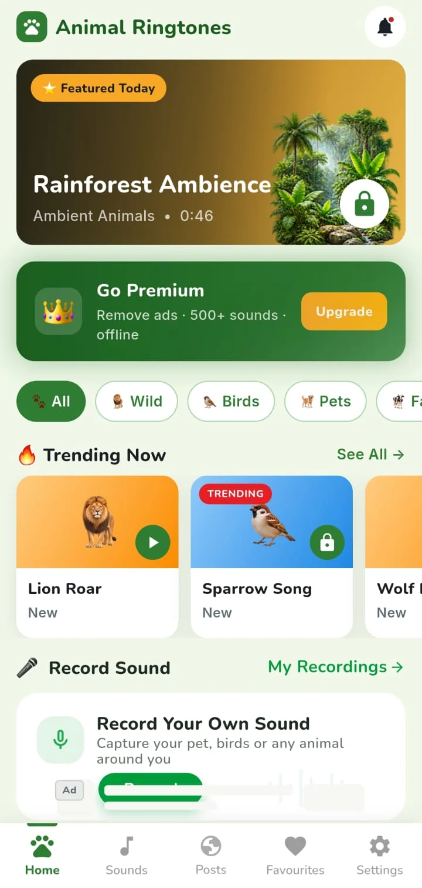
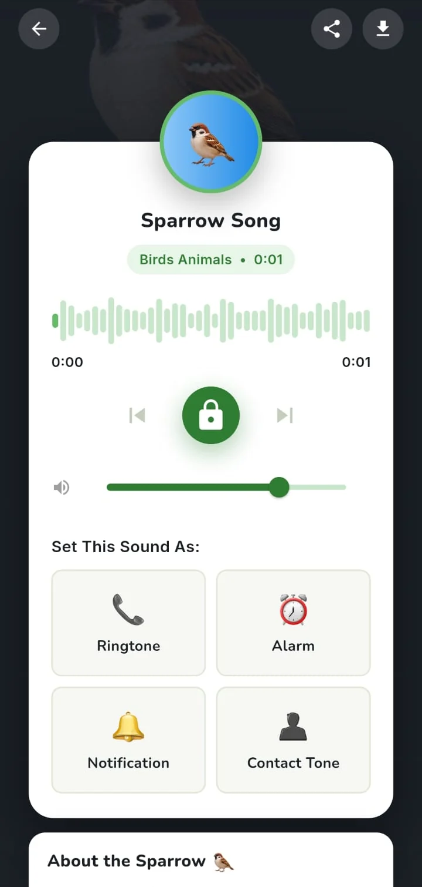
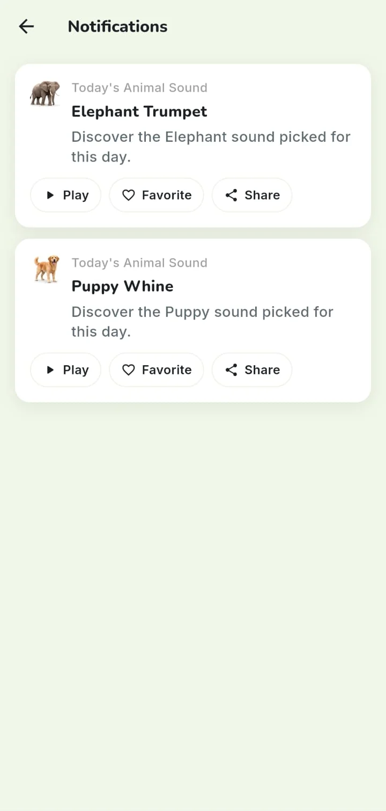
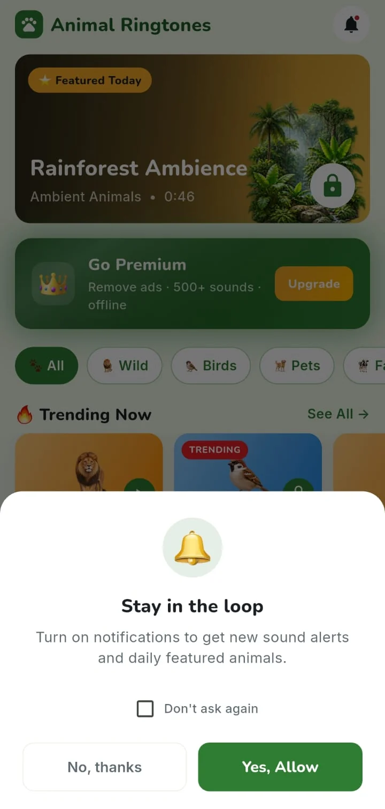
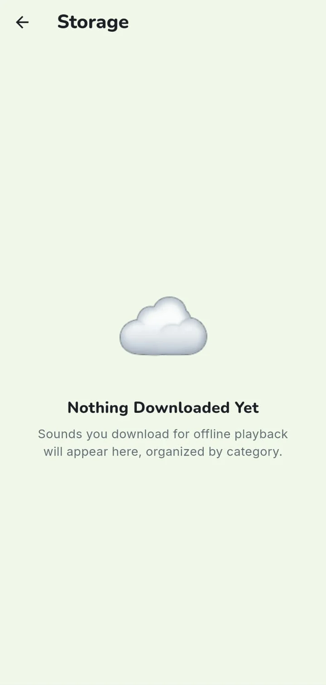
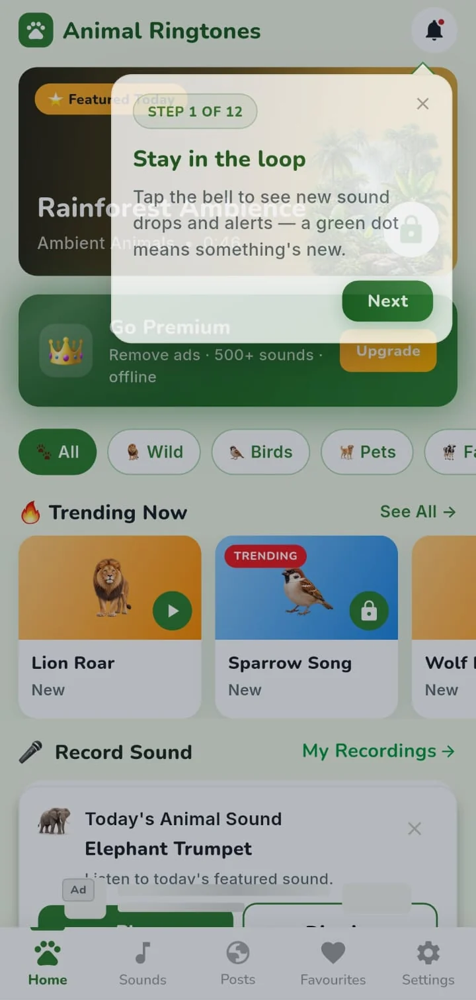
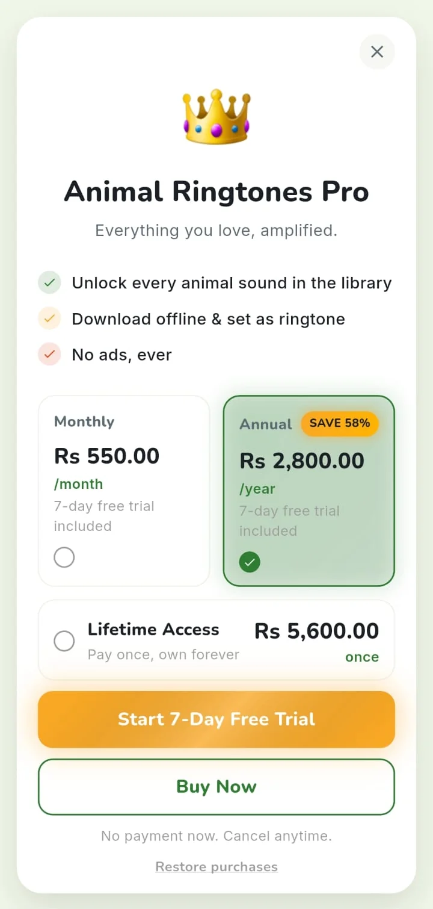
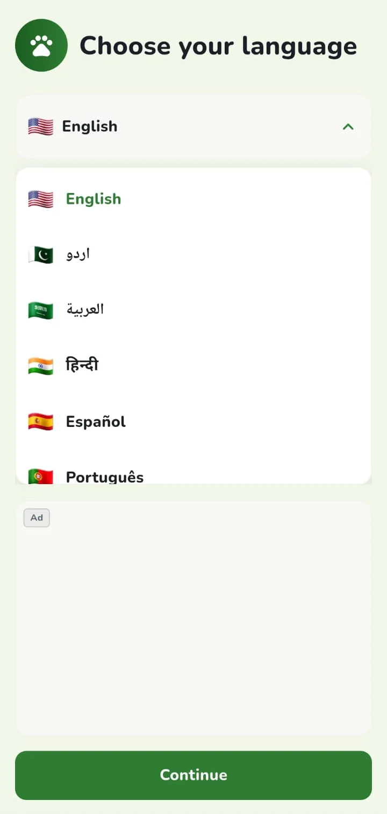

# Product Overview

All screenshots on this page are real captures from the Android app, with system status bars removed.

## What it is

Animal Ringtone is a mobile sound library of animal and bird sounds. Users browse and preview sounds, save favourites, download them for offline use, and, on Android, set a sound as the phone's ringtone, alarm, notification tone or the tone for a single contact. They can also record their own sound and publish it to a community feed.

It is a Flutter app for Android and iOS, locked to portrait on Android, with a Cloudflare Workers backend and Firebase services. The public store listing is on [Google Play](https://play.google.com/store/apps/details?id=com.animalringtones.sounds.ringtone&hl=en).

## Navigation

A five-tab shell keeps each tab's state: **Home**, **Sounds**, **Posts**, **Favourites**, **Settings**. Detail screens (player, notifications, paywall, recording flow, storage, language) sit above the shell.

<table>
  <tr>
    <td align="center"> Home: featured sound, premium banner, categories, trending, record entry</td>
    <td align="center"> Player with the Set This Sound As actions</td>
    <td align="center"> Notification centre with Today's Animal Sound</td>
  </tr>
</table>

## Core flows

**Discover and play.** Sounds are grouped into seven categories: wild, birds, pets, farm, ocean, funny and ambient. Users can search, filter by category, favourite, and see recently played. One shared player drives the card mini-controls and the full player screen, so they always agree.

**Set as.** On Android the player offers four targets: ringtone, alarm, notification and contact tone. The first three write the system default. Contact tone opens the contact picker and assigns a custom ringtone to that contact. On iOS, where Apple provides no API for this, the app explains the limitation and offers sharing the file as an alternative.

**Offline.** Sounds can be downloaded. Android users can also export a download into the public Music folder so it appears in the Files app. Sounds that were only streamed are cached automatically after first play, and Settings → Storage shows both kinds and lets the user remove them.

**Record and post.** A recording flow explains the microphone permission, records a short clip with a duration cap, lets the user preview, rename and manage recordings, and optionally post to the feed (sign-in required). Posts can be liked, shared, reported, or their author blocked.

**Notifications.** The app shows a permission pre-prompt before the system dialog, with a "Don't ask again" option. It supports push messages, local notifications, an in-app notification centre, and a daily featured sound chosen deterministically by calendar day.

<table>
  <tr>
    <td align="center"> Permission pre-prompt</td>
    <td align="center"> Storage management</td>
    <td align="center"> Guided tour (12 steps)</td>
  </tr>
</table>

## Access and monetisation

Sound access is resolved per category in catalog order:

1. The first few sounds in each category are **free**.
2. A minimum number of the remainder are **premium-only** (purchase).
3. Every other sound is **rewarded**: watching an ad unlocks that one sound for one hour, or the user can subscribe.

Premium is offered as a monthly plan, an annual plan with a 7-day trial, and a lifetime purchase, with restore-purchases support. Premium users see no ads. Ads (banner, native, interstitial, rewarded) are controlled by remote per-placement flags and a global kill switch.

## Accounts

Google and Apple sign-in. Guests can use the library; community features require sign-in. Favourites, recents, search history and settings sync to the signed-in account. Users can sign out, reset the app, or delete their account and data.

## Localisation

The interface is localised into 15 languages and the first-run flow starts with language selection.

Continue with the [technical case study](TECHNICAL_CASE_STUDY.md).
